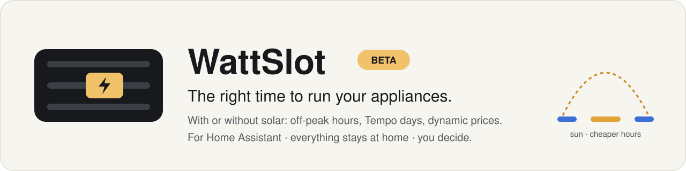
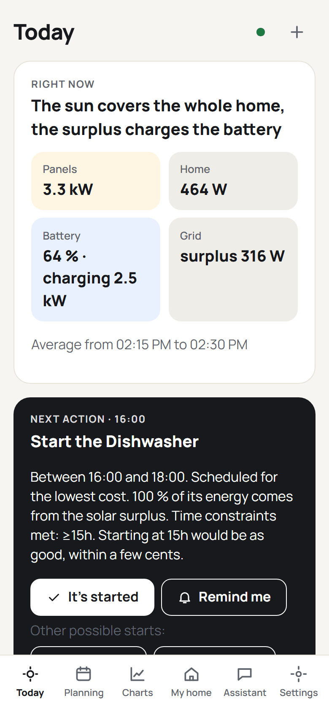
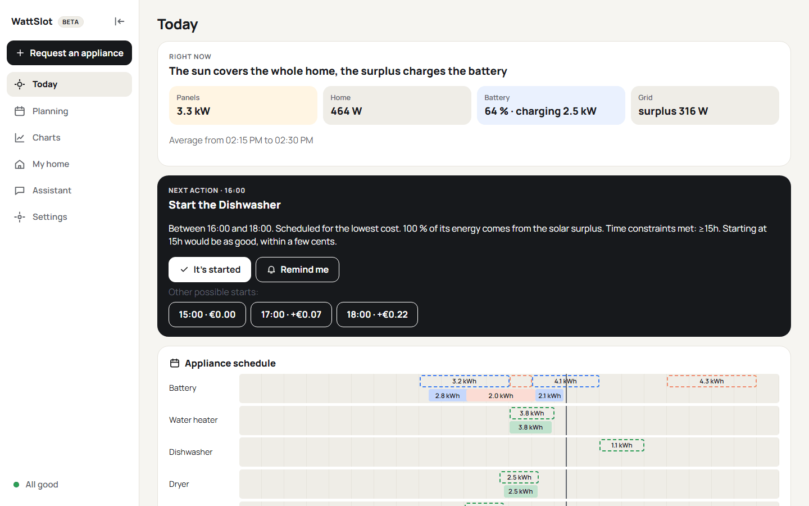

<p align="center">
  <picture>
    <source media="(prefers-color-scheme: dark)" srcset="docs/images/banner-en-dark.svg">
    
  </picture>
</p>

<p align="center">
  <a href="https://github.com/sponsors/jmcruvellier"></a>
  &nbsp;
  <a href="https://ko-fi.com/jmcruvellier"></a>
</p>

*[Version française](README.fr.md)*

**WattSlot finds the right slot to run your household appliances**, so you use your own solar power or the cheapest hours of your electricity contract. It reads your home from Home Assistant, plans the day and the week, and tells you what to start and when: it recommends, you decide.

## Who is it for?

- **No solar panels or battery needed.** A contract whose price changes with the time of day is enough: off-peak hours, colour days (such as EDF Tempo) or dynamic prices. With panels or a battery, WattSlot also plans around the sun and the charge.
- **For everyone.** Once installed, the everyday screens speak plain language: no formula, no YAML, nothing technical to learn for most features.
- **Light.** It runs as an app inside Home Assistant (an entry in the official app store is planned), or on a separate host with Docker for those who prefer.

<p align="center">
  
  &nbsp;
  
</p>

## Features

- **Reads your home from Home Assistant**: the Energy dashboard gives the solar production, the grid, the battery and the tracked appliances; past data comes from the statistics. Nothing to type in to get started.
- **Daily plan and seven-day horizon**: when to start each appliance, when to charge or discharge the battery, from the solar forecast and your prices (single price, off-peak hours, colour days, dynamic prices read from an entity).
- **Your home, your rules**: appliance behaviours, time windows, recurrences, battery settings, and what to optimise (cost, self-consumption, grid draw, CO₂). Ready-made templates, backup and sharing.
- **Made for every day**: Today, Planning, Charts, My home, Assistant, Settings. Phone first, five themes with automatic light and dark, six languages.
- **Requests and reminders**: ask for an appliance from the app or from Home Assistant's Assist, get notified at the right time.
- **Data you can trust**: WattSlot checks your sensors, flags glitches and lets you correct them, so one wrong reading does not spoil the rest.
- **Assistant (optional)**: a built-in MCP server lets Home Assistant's Assist answer questions about your plan, with the language model you already use.

## Beta: we need you

WattSlot is used every day on its author's home and is now looking for testers. Your feedback decides what comes next.

- **[Give feedback](https://github.com/jmcruvellier/wattslot/issues/new?template=beta_feedback.yml)**: what works, what bothers you, what you did not understand. The same link is in the app, at the bottom of **Settings**.
- **Known limits**:
  - WattSlot **recommends only**: it never starts an appliance and never controls your battery. You start the appliance, or you build the automation yourself.
  - It starts from Home Assistant's **Energy dashboard**: it must be set up.
  - The beta is tested mostly on French contracts (off-peak hours, Tempo). Other tariffs work, and your feedback on them is especially welcome.
- **Native speakers wanted**: the German, Dutch, Spanish and Italian translations need a native proofreader. See [CONTRIBUTING.md](CONTRIBUTING.md) or open a [translation issue](https://github.com/jmcruvellier/wattslot/issues/new/choose).

## Privacy

- WattSlot runs **entirely at home**: no account, no cloud service, no telemetry.
- Your home, settings, measurements and plans stay in its data folder, included in Home Assistant's backups.
- Nothing about you leaves your home. Besides Home Assistant, WattSlot only calls **Open-Meteo** for the solar forecast, when Home Assistant gives none (location rounded to about 1 km), and GitHub to learn about new versions. Details in [Privacy](docs/privacy.md).

## Requirements

- **Home Assistant OS or Supervised** to install WattSlot as an app, on `amd64` or `aarch64` (Raspberry Pi 5 with an SSD, mini PC…). See the [hardware advice](docs/installation.md).
- Or **Docker** next to any Home Assistant installation (standalone mode, below).
- Home Assistant's **Energy dashboard** set up.

## Installation

### As a Home Assistant app (recommended)

[](https://my.home-assistant.io/redirect/supervisor_add_addon_repository/?repository_url=https%3A%2F%2Fgithub.com%2Fjmcruvellier%2Fwattslot%23addon)

1. Click the button above, or add `https://github.com/jmcruvellier/wattslot#addon` in **Settings → Apps → App store → ⋮ → Repositories**.
2. Install **WattSlot**, tick **Show in sidebar**, then **Start**.
3. Open WattSlot from the sidebar and follow the first steps: they check the connection, the devices found in your Energy dashboard, your contract, and compute a first plan.

Updates arrive like any other app, with Home Assistant's automatic backup.

### Standalone (Docker)

```bash
docker run -d --name wattslot --restart unless-stopped \
  -p 8100:8100 -v wattslot-data:/data \
  -e HA_URL=http://homeassistant.local:8123 \
  ghcr.io/jmcruvellier/wattslot:latest
```

Open `http://<host>:8100` and sign in with Home Assistant from the connection page (or pass a long-lived access token in `HA_TOKEN`). Keep port 8100 on your local network only.

## Documentation

- [User guide](docs/) (installation, first steps, screens, tariffs, battery, assistant, FAQ)
- [Changelog](ha-addon/wattslot/CHANGELOG.md)

## Help and contributing

- **Questions and ideas**: the [Discussions](https://github.com/jmcruvellier/wattslot/discussions), in English or French.
- **Bugs**: [open an issue](https://github.com/jmcruvellier/wattslot/issues/new/choose) and attach the anonymised report from **Settings → App status → Prepare a report**.
- **Contributing** (code, translations): [CONTRIBUTING.md](CONTRIBUTING.md). **Security**: [SECURITY.md](SECURITY.md).

## Support WattSlot

WattSlot is free and open source, with no ads and no data collection. If it saves you money, you can support its development, monthly or once:

<p>
  <a href="https://github.com/sponsors/jmcruvellier"></a>
  &nbsp;
  <a href="https://ko-fi.com/jmcruvellier"></a>
</p>

## License

[Apache License 2.0](LICENSE). WattSlot gives recommendations and does not control your devices; it comes with no warranty (see the license).
