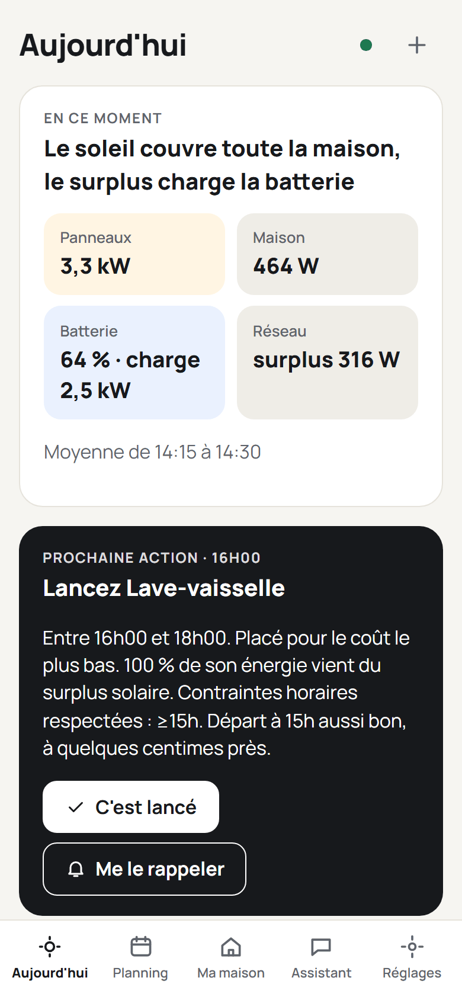

# Guide d'utilisation de WattSlot

*[English version](../README.md)*

WattSlot trouve le bon créneau pour lancer vos appareils : quand votre électricité solaire est là, ou quand l'électricité est la moins chère. Il lit votre maison dans Home Assistant, calcule un plan pour aujourd'hui et la semaine, et vous dit quoi lancer et quand. Il recommande ; vous décidez.

## Par où commencer

| Votre maison | Commencez par |
|---|---|
| Des panneaux solaires, avec ou sans batterie | [Installation](installation.md), puis [Premiers pas](getting-started.md) |
| Pas de panneaux, mais des heures creuses, des jours de couleur (Tempo) ou des prix dynamiques | Les mêmes : WattSlot planifie alors selon vos seuls prix ([Tarifs](tariffs.md)) |
| Déjà installé, vous voulez comprendre un écran | [Les écrans](screens.md) |
| Quelque chose ne va pas | [Dépannage et questions fréquentes](troubleshooting.md) |

## Toutes les pages

1. [Installation](installation.md) : comme application de Home Assistant ou avec Docker, mises à jour, sauvegardes.
2. [Premiers pas](getting-started.md) : les premiers pas guidés, la reprise de l'historique.
3. [Les écrans](screens.md) : Aujourd'hui, Planning, Ma maison, Assistant, Réglages.
4. [Votre maison et ses règles](your-home.md) : appareils, plages horaires, récurrences, demandes, modèles, objectif.
5. [Tarifs](tariffs.md) : prix unique, heures creuses, jours de couleur, prix dynamiques, revente du surplus.
6. [Batterie](battery.md) : plancher, puissances, charge complète, comment le plan s'en sert.
7. [Notifications et rappels](notifications.md).
8. [Assistant vocal](assistant.md) : l'Assist de Home Assistant répond sur votre énergie.
9. [Dépannage et questions fréquentes](troubleshooting.md).
10. [Confidentialité](privacy.md) : ce qui reste chez vous, les seules connexions sortantes.
