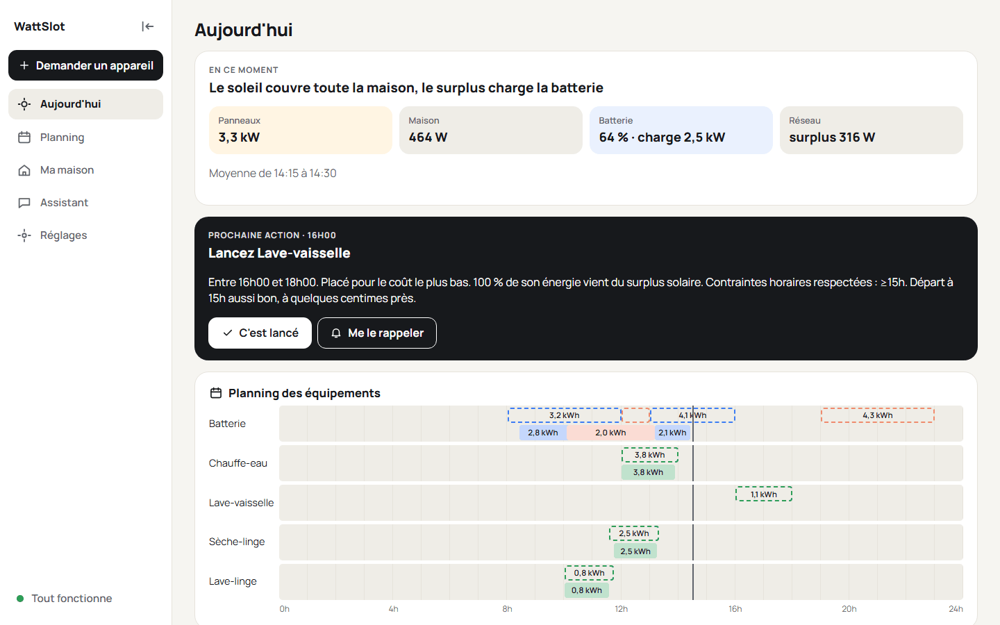
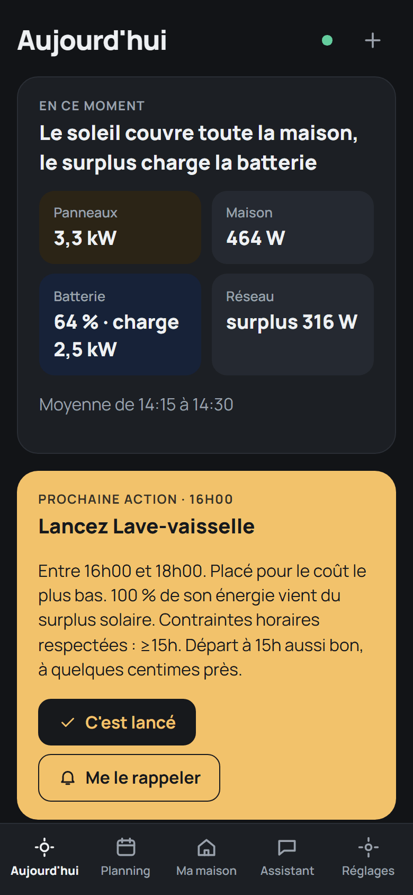
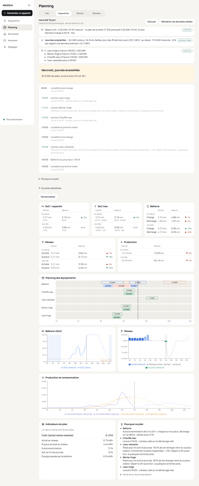
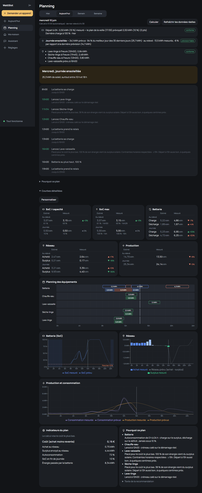
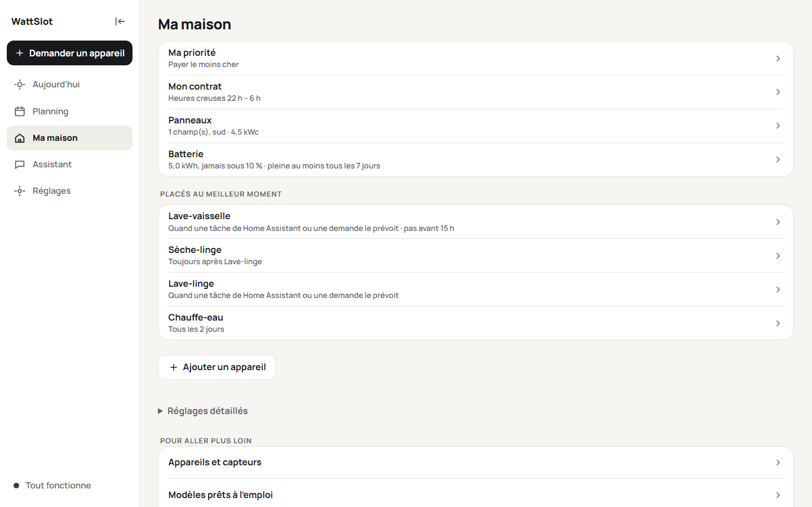
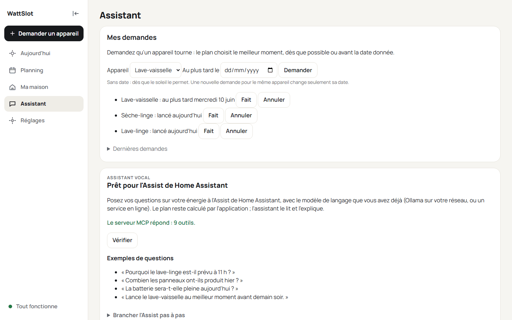
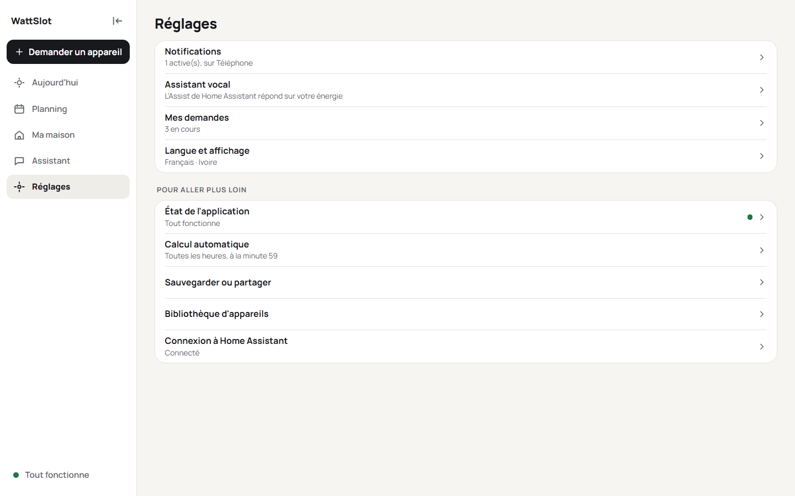
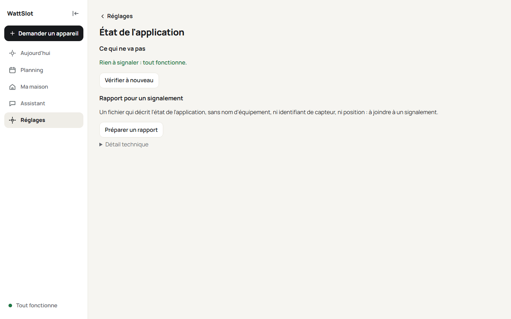

# Les écrans

*[English version](../screens.md) · [Guide d'utilisation](README.md)*

Cinq sections, dans le menu en bas de l'écran sur un téléphone, à gauche sur un ordinateur (il se replie en icônes avec la flèche en haut). Deux choses sont toujours à portée : la **pastille d'état** (verte : tout fonctionne ; orange : à vérifier ; rouge : le calcul est bloqué) et **Demander un appareil** (le bouton `+`).

## Aujourd'hui

Ce dont vous avez besoin tout de suite.

- **En ce moment** : la moyenne du dernier quart d'heure pour les panneaux, la maison, la batterie (qui charge ou fournit) et le réseau (achat ou surplus).
- **Prochaine action** : le prochain appareil à lancer et son créneau, par exemple *Lancez le lave-linge, entre 11 h 15 et 13 h 30*. **C'est lancé** indique à l'application que vous l'avez fait ; **Me le rappeler** envoie une notification au bon moment (voir [Notifications](notifications.md)).
- **Batterie** et **Soleil** : la charge maintenant, son point le plus haut et son niveau à minuit ; l'énergie solaire prévue et déjà produite.
- **Planning des équipements** : une ligne par équipement, le créneau prévu en haut (en pointillés) et ce qui a été mesuré en dessous (plein), avec l'énergie de chaque bloc. Touchez un bloc pour son détail.

## Planning

Le plan en détail, pour **Hier**, **Aujourd'hui**, **Demain** et la **Semaine**.

- En haut, l'heure du calcul, **Calculer** (recalculer maintenant) et **Rafraîchir les données réelles**.
- Des bandeaux pour l'essentiel : avertissements, batterie à minuit, production prévue comparée à la production mesurée.
- **La journée en agenda** : ce qui se passe, et quand.
- **Pourquoi ce plan** : l'explication de chaque décision, en clair.
- **Courbes détaillées** (repliées) : cartes de synthèse (batterie, réseau, production, estimé et mesuré), le Planning des équipements, la charge de la batterie, les échanges avec le réseau et les courbes de production et de consommation, prévues (en pointillés) et mesurées.
- **Personnaliser** choisit les cartes affichées et leur ordre.
- **Semaine** : une carte par jour avec son soleil, les appareils prévus et la batterie, puis les courbes de la semaine.

## Ma maison

Votre maison en phrases : votre priorité (payer le moins cher, consommer mon soleil…), votre contrat, vos panneaux, votre batterie, les appareils placés au meilleur moment et ceux seulement suivis.

- **Réglages détaillés** (repliés) ouvre chaque réglage : voir [Votre maison et ses règles](your-home.md), [Tarifs](tariffs.md) et [Batterie](battery.md).
- **Pour aller plus loin** : **Appareils et capteurs** (les équipements lus dans Home Assistant, ajouter un équipement), **Modèles prêts à l'emploi**, **Sauvegarder ou partager** (exporter ou importer votre maison dans un fichier), **Graphe de la maison** et **Bibliothèque d'appareils** (pour les curieux).

## Assistant

**Mes demandes** (les appareils que vous avez demandés, avec ou sans échéance) et le branchement de l'**assistant vocal** : voir [Assistant vocal](assistant.md).

## Réglages

- **Notifications** : quels messages, sur quel appareil, heures de silence ([Notifications](notifications.md)).
- **Calcul automatique** : chaque heure à une minute donnée (59 par défaut), ou à la main ; la liste de tâches de Home Assistant dont les tâches deviennent des demandes.
- **Langue et affichage** : six langues, cinq thèmes (Ivoire, Graphite, Océan, Prairie, Crépuscule) ou **Automatique**, qui suit le mode clair ou sombre de votre appareil.
- **État de l'application** : ce qui ne va pas, s'il y a lieu, et comment le corriger ; la version, et s'il en existe une nouvelle ; les liens pour soutenir le projet ; un rapport à joindre à un signalement ([Dépannage](troubleshooting.md)).
- **Connexion à Home Assistant** (mode autonome).

