# The screens

*[Version française](fr/screens.md) · [User guide](README.md)*

Six sections, in the menu at the bottom of the screen on a phone, on the left on a computer (it folds into icons with the arrow at its top). Two things are always at hand: the **status dot** (green: all good; orange: needs a look; red: planning is blocked) and **Request an appliance** (the `+` button).

## Today

What you need right now.

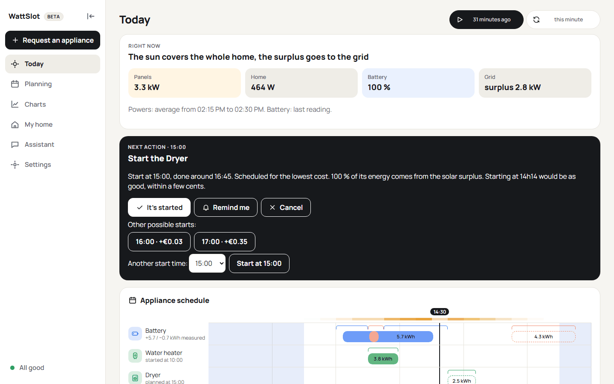

- **Right now**: the average of the last quarter hour for the panels, the home, the battery (charging or supplying) and the grid (buying or surplus).
- **Next action**: the next appliance to start and its slot, for instance *Start the washing machine: start at 11:15, done around 13:30*; once that time has passed without the cycle being seen, the block says so and asks you to start it as soon as you can. **It's started** tells the app you did it: the block moves on to the next appliance, on every device, for the rest of the day (**Not started yet** takes it back, until the app sees the cycle in the measurements); **Remind me** sends a notification at the right time (see [Notifications](notifications.md)); **Another start time** lets you pick the hour yourself, as on the timeline. When nothing is left to start, the block says why: everything is started, the planning was cancelled for today, or no appliance is planned today.
  - **Other possible starts**: up to three other starts the plan allows, with what they change to the cost. Choosing one imposes it on today's calculation, which runs again; **Back to the calculation's choice** undoes it. When the battery's full charge is due, the text says why a cheaper start was set aside.
- **Battery** and **Sun**: the charge now, its highest point and its level at midnight; the solar energy expected and already produced.
- **Appliance schedule**: one line per device, the planned slot on top (dotted) and what was measured below (filled), with the energy of each block. Tap a block for its details.

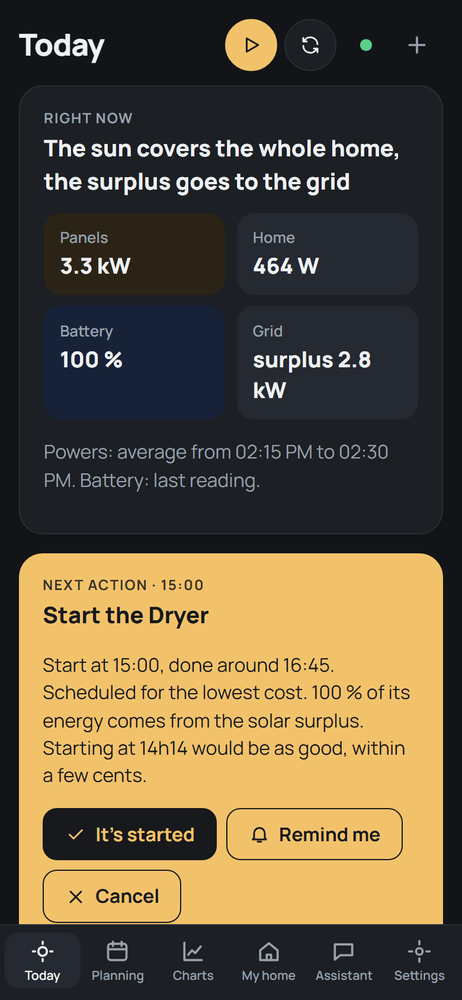

## Planning

The plan in detail, for **Yesterday**, **Today**, **Tomorrow**, the following days (**D+2** to **D+6**) and the **Week**.

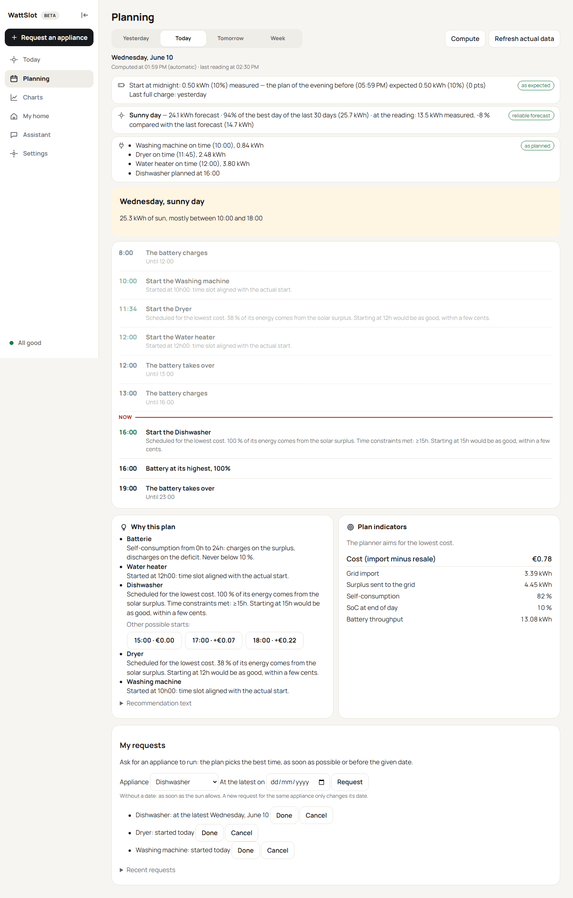

- At the top, the computation time, **Compute** (recalculate now) and **Refresh actual data**.
- Banners for what matters: warnings, the battery at midnight, the forecast production compared with what was measured.
- **The day as an agenda**: what happens and when.
  - An appliance can start in the evening and finish the next day, when the night hours are cheaper (or the battery still covers them): its end time is the next day's, and the next day starts with the end of the cycle.
- **Why this plan**: the explanation of each decision, in plain words.
  - Today, the other possible starts of each appliance can be chosen here too.
- **Plan indicators** (cost, purchases, surplus, self-consumption…): for the whole day, measured for the hours already past, planned for the rest.
  - In its corner, the **forecast quality** (reliable, fair or uncertain) tells how far to trust the planned production and consumption, from the data the calculation had: days of history behind the usual consumption, its regularity, the source of the solar forecast, how many days ahead the weather is forecast. Tap it for the reason behind each criterion.
- **My requests** (under each tab): the appliances you asked for, with or without a deadline, to mark done or cancel.
  - The same appliance can run **several times in a day** (two loads of laundry, two heats of the water heater): ask for it again. If it already has a pending request, choose **Add a cycle** rather than **Change the date**. Each cycle gets its own slot, after the previous one; the second one is named with its rank (*Washing machine #2*) in **Next action**, the agenda and the notifications, and has its own departure choice, **Cancel** and **It's started**. A dryer set to start after the washing machine follows the load of the same rank.
  - So that wet laundry does not wait, the settings of the dryer (**My home**, its cycle rules) take a limit next to **Starts after the end of**: **At the latest** so many hours after it ends. The calculation then keeps the two cycles close; if the limit cannot be kept, the dryer is placed as close as it can be and a warning of the plan says so. Empty, there is no limit.
- **Week**: the coming days as an agenda, one line per day with what is planned; tap a day to open it.

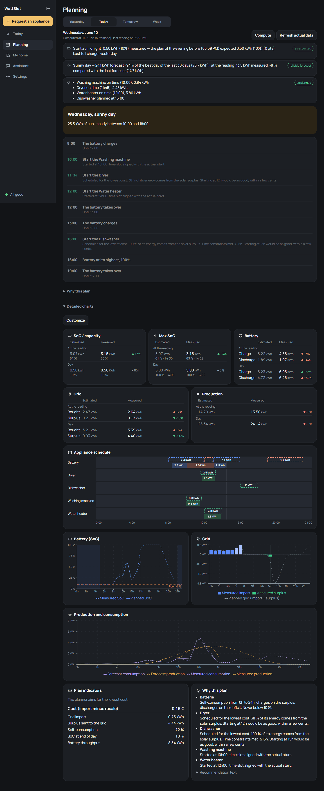

## Charts

The figures and charts of the plan, with the same tabs as Planning.

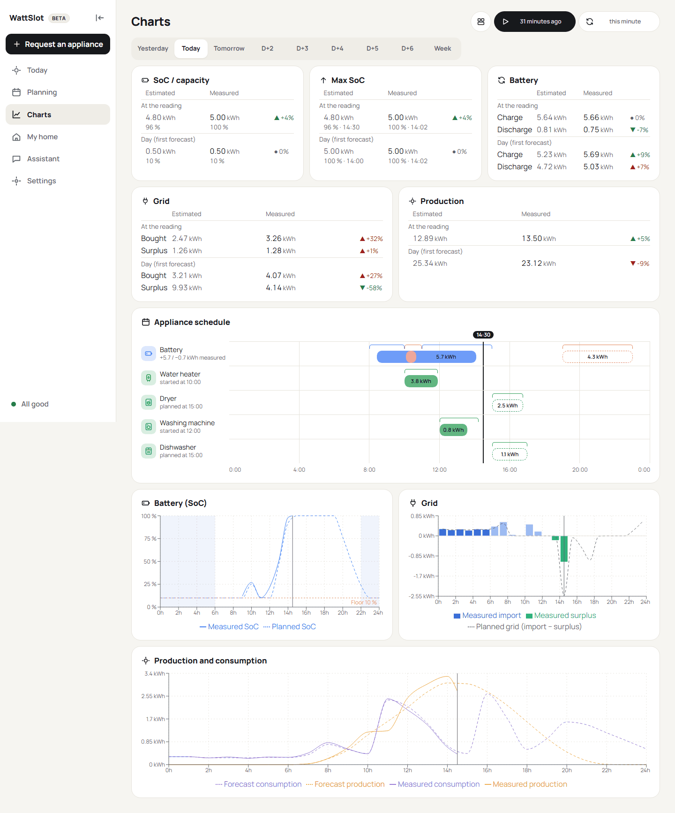

- **A day**: summary cards (battery, grid, production, estimated against measured), the appliance schedule, the battery charge, the grid exchanges and the production and consumption curves, planned (dotted) and measured.
  - Tap a planned appliance in the schedule to change its start: one of the other starts the plan offers, or a time of your choice, today, tomorrow or a following day. Cancelling the launch is for today only.
- **Customize** chooses which cards appear and their order (the following days share Tomorrow's).
- A measurement the home cannot reach (a meter counting thousands of kWh in one hour) is set aside: a gap in the curves, nothing in the totals, and a line above the cards with **See the data** (**My home › Data**). The line appears on **Today**, **Planning** and **Charts**, only while the viewed range covers it: on **Yesterday** for a measurement of the day before, on **Week** only while it is today's. The other measurements stay displayed. Correcting the measurement in **My home › Data** (**Estimate** or **Recompute**) fills the gap.
- **Week**: a table with one row per day (weather, production, battery, purchases including peak hours, surplus, appliances); tap a day to unfold its details (appliances and their times, warnings, **See the detail**). On a phone, the table keeps day, production, battery and purchases, the rest is in the details. Then the week's charts.

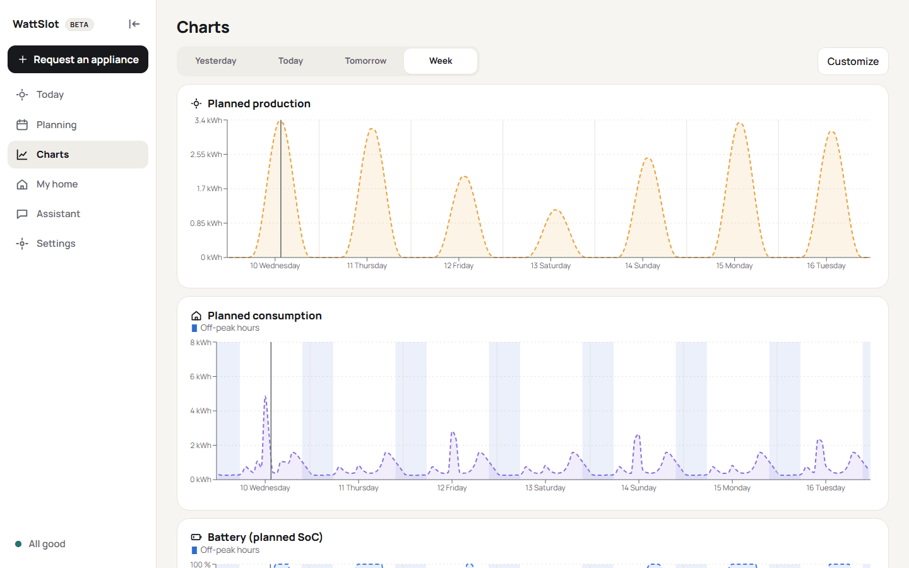

## My home

Your home in plain sentences, in four tabs. Tap a line: its setting opens on its own, with its own **Save settings** button (from the bottom of the screen on a phone, in a window on a computer).

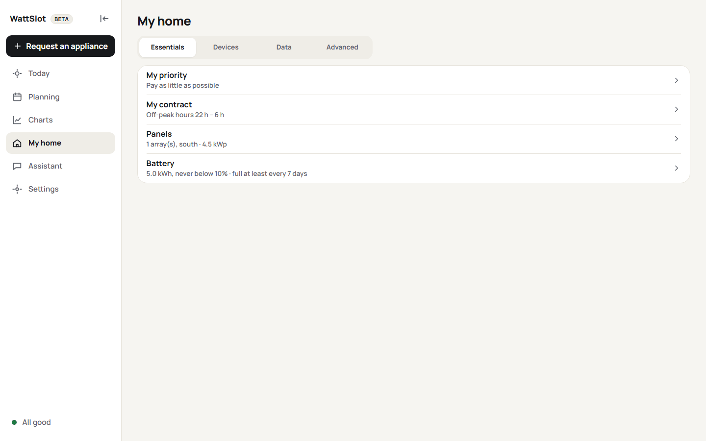

- **Essentials**: your priority (pay as little as possible, use my own sun…), your contract, your grid connection (single-phase or three-phase), your panels and your battery: see [Tariffs](tariffs.md), [Your home and its rules](your-home.md#three-phase-homes) and [Battery](battery.md).
- **Devices**: the appliances placed at the best time, then, folded, those only monitored (often many plugs, with a search field), the production, grid and battery, and the devices Home Assistant suggests but WattSlot does not follow yet; **Add a device** and **Re-read Home Assistant**. Each device opens its sheet: its rules (see [Your home and its rules](your-home.md)), then, folded, its **sensors, name and type**, with the points to check and **Remove from my home**.
- **Data**: the check of your meters' data. A meter that counts more than the home can draw (a sensor dropout counted as a reset: thousands of kWh in one hour) is corrected automatically: recomputed from the raw readings while they are kept (three days), otherwise set aside, so the calculation and the charts ignore it. Each correction opens in a sheet: what happened, what was done, and the other choices (recompute, estimate from the neighbouring hours, set aside, undo). The original data is never changed. Correcting here also repairs the day's curves: **Recompute** and **Estimate** fill the gap left by an impossible measurement, **Set aside** keeps it; the day's totals follow. **Check a period** analyses one meter or all of them over the days you choose.

  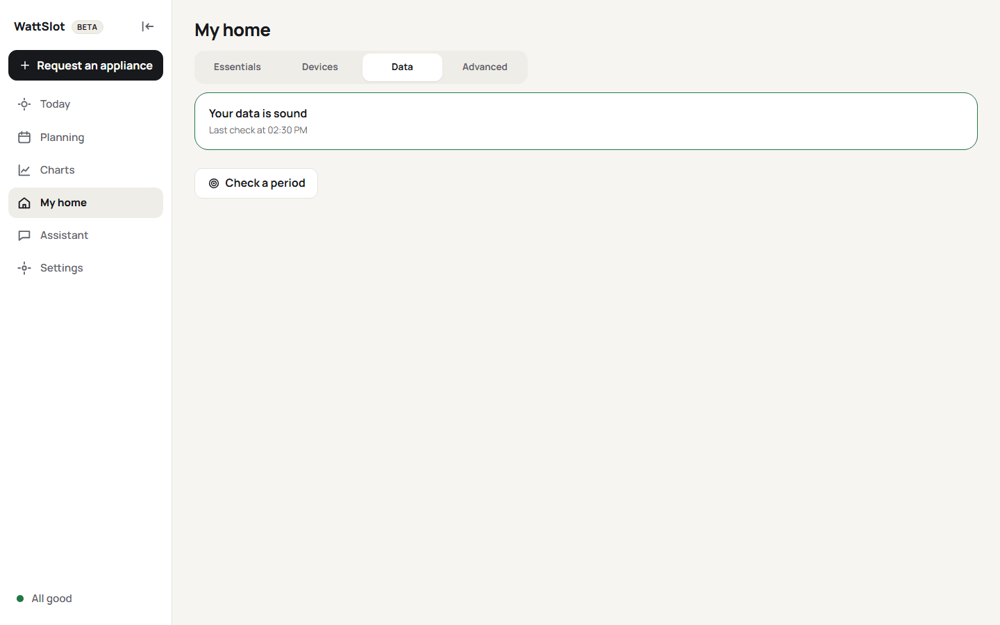

- **Advanced**: **Import the rules of Home Assistant tasks**, then **Ready-made templates**, **Back up or share** (export or import your home as a file), **Home graph** and **Appliance library** (for the curious), and the glossary.

## Assistant

**Chat with the assistant** and the setup of the **voice assistant**: see [Voice assistant](assistant.md).

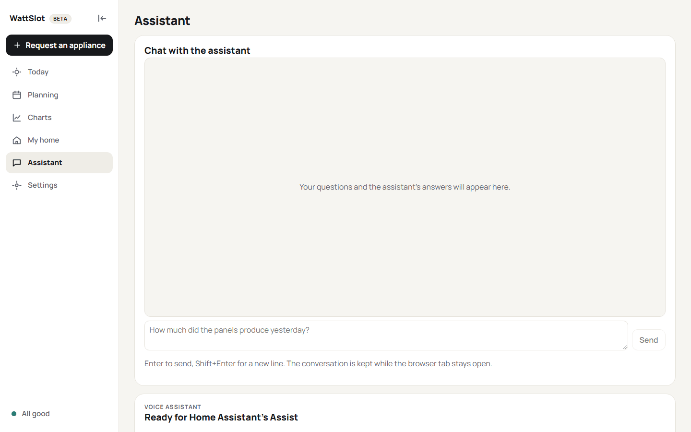

## Settings

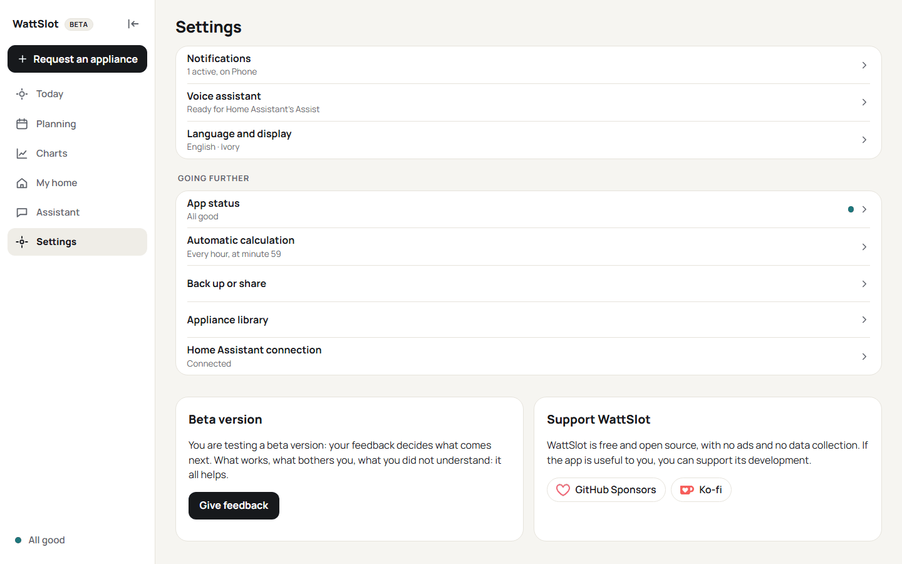

- **Notifications**: which messages, on which device, quiet hours ([Notifications](notifications.md)).
- **Automatic calculation**: every hour at a given minute (59 by default), or by hand; the Home Assistant to-do list whose tasks become requests.
- **Language and display**: six languages, five themes (Ivory, Graphite, Ocean, Meadow, Dusk) or **Automatic**, which follows your device's light or dark mode, and the **currency** of your prices and costs. By default it is Home Assistant's (Settings › System › General); changing it does not convert the prices already entered.
- **App status**: what is wrong, if anything, and how to fix it; the version, and whether a new one exists; links to support the project; the resources the app uses (processor averaged over 15 minutes, memory, its data on disk, the free space on that disk and what it writes to it); a report to attach to a bug report ([Troubleshooting](troubleshooting.md)).
- **Home Assistant connection** (standalone mode).
- At the bottom, **Beta version**, with **Give feedback** (a ready-made form on GitHub), and **Support WattSlot** (GitHub Sponsors and Ko-fi).

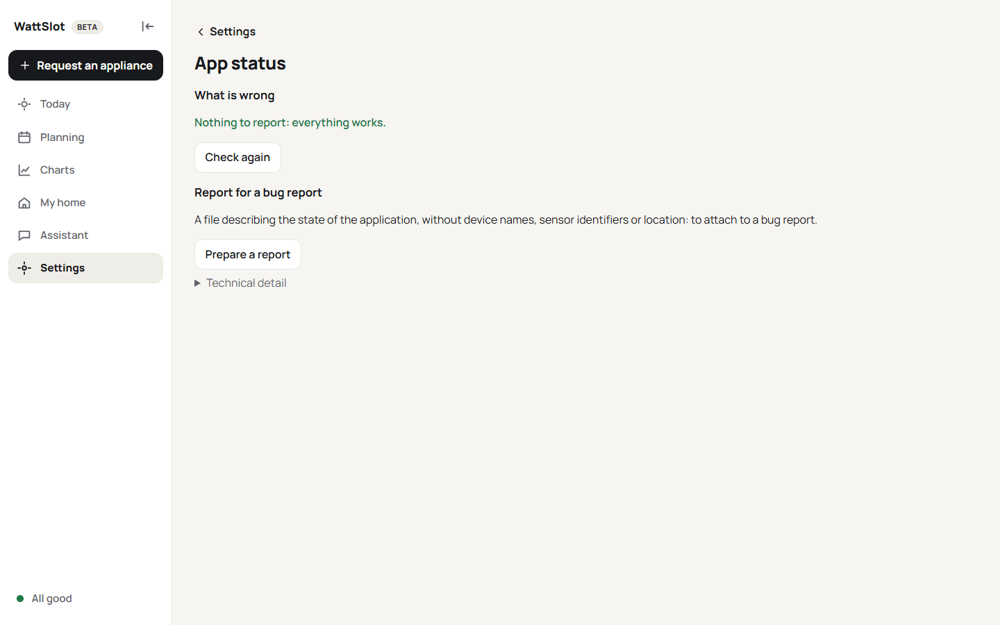
