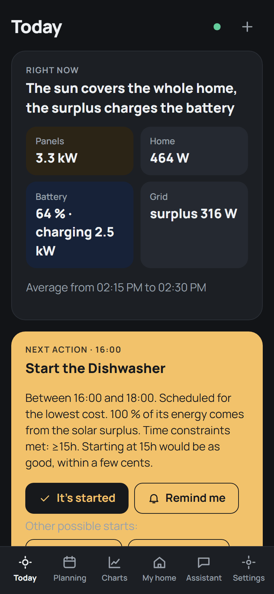
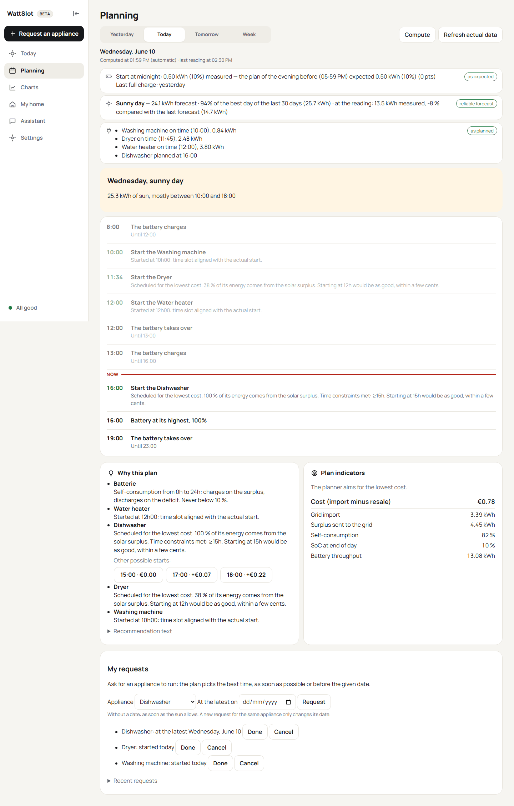
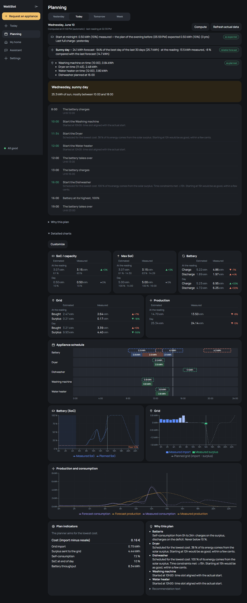
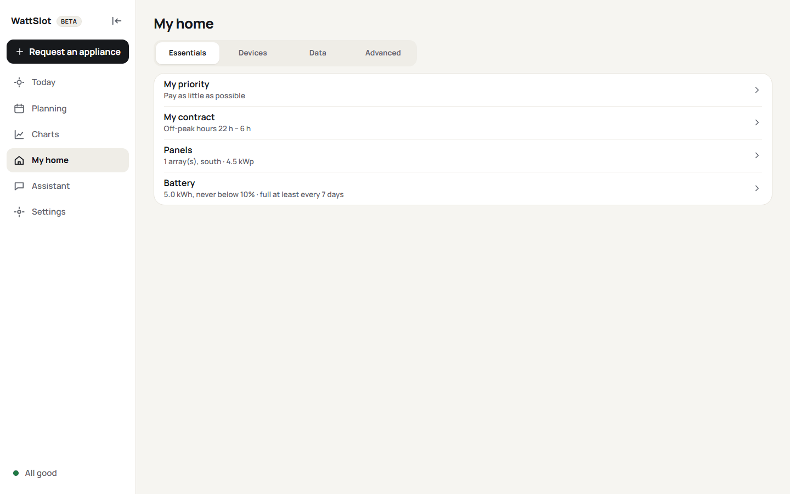
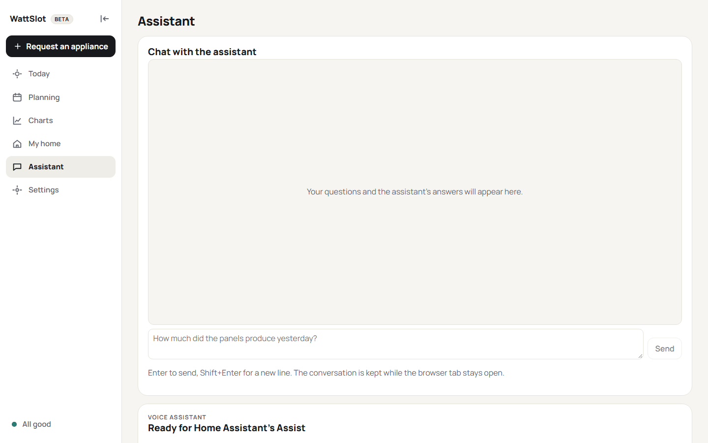
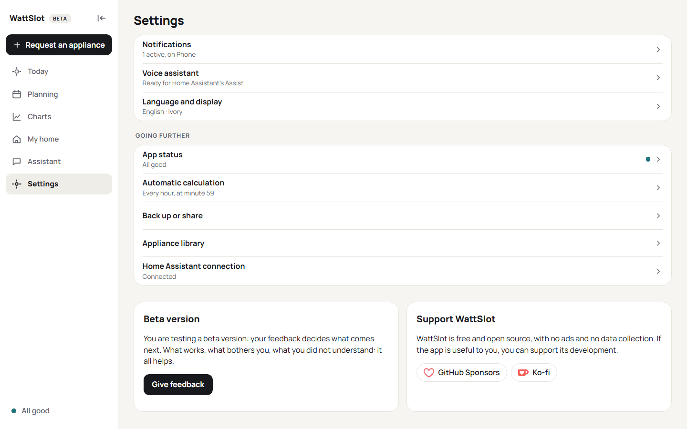
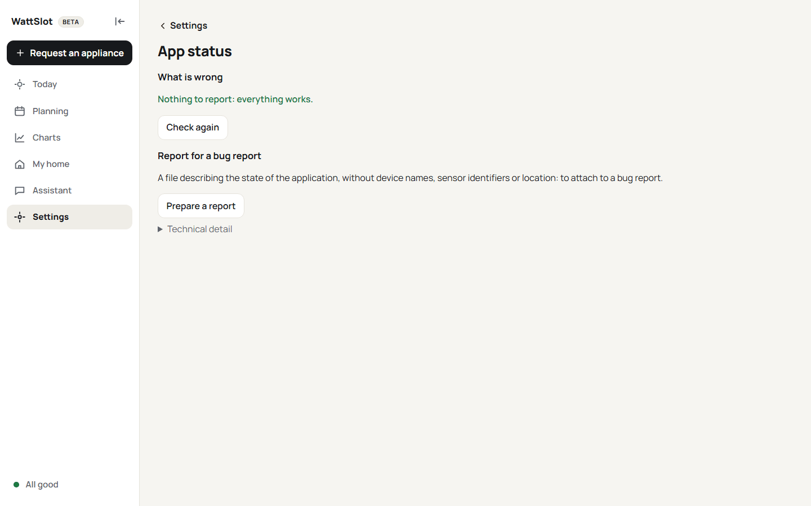

# The screens

*[Version française](fr/screens.md) · [User guide](README.md)*

Five sections, in the menu at the bottom of the screen on a phone, on the left on a computer (it folds into icons with the arrow at its top). Two things are always at hand: the **status dot** (green: all good; orange: needs a look; red: planning is blocked) and **Request an appliance** (the `+` button).

## Today

What you need right now.

- **Right now**: the average of the last quarter hour for the panels, the home, the battery (charging or supplying) and the grid (buying or surplus).
- **Next action**: the next appliance to start and its slot, for instance *Start the washing machine, between 11:15 and 13:30*. **It's started** tells the app you did it; **Remind me** sends a notification at the right time (see [Notifications](notifications.md)).
- **Battery** and **Sun**: the charge now, its highest point and its level at midnight; the solar energy expected and already produced.
- **Appliance schedule**: one line per device, the planned slot on top (dotted) and what was measured below (filled), with the energy of each block. Tap a block for its details.

## Planning

The plan in detail, for **Yesterday**, **Today**, **Tomorrow** and the **Week**.

- At the top, the computation time, **Compute** (recalculate now) and **Refresh actual data**.
- Banners for what matters: warnings, the battery at midnight, the forecast production compared with what was measured.
- **The day as an agenda**: what happens and when.
- **Why this plan**: the explanation of each decision, in plain words.
- **Detailed charts** (folded): summary cards (battery, grid, production, estimated against measured), the appliance schedule, the battery charge, the grid exchanges and the production and consumption curves, planned (dotted) and measured.
- **Customize** chooses which cards appear and their order.
- A measurement the home cannot reach (a meter counting thousands of kWh in one hour) is set aside: a gap in the curves, nothing in the totals, and a line above the cards with **See the data** (**My home › Data**).
- **Week**: a table with one row per day (weather, production, battery, purchases including peak hours, surplus, appliances); tap a day to unfold its details (appliances and their times, warnings, **See the detail**). On a phone, the table keeps day, production, battery and purchases, the rest is in the details. Then the week's charts.

## My home

Your home in plain sentences, in four tabs. Tap a line: its setting opens on its own, with its own **Save settings** button (from the bottom of the screen on a phone, in a window on a computer).

- **Essentials**: your priority (pay as little as possible, use my own sun…), your contract, your panels and your battery: see [Tariffs](tariffs.md) and [Battery](battery.md).
- **Devices**: the appliances placed at the best time, then, folded, those only monitored (often many plugs, with a search field), the production, grid and battery, and the devices Home Assistant suggests but WattSlot does not follow yet; **Add a device** and **Re-read Home Assistant**. Each device opens its sheet: its rules (see [Your home and its rules](your-home.md)), then, folded, its **sensors, name and type**, with the points to check and **Remove from my home**.
- **Data**: the check of your meters' data. A meter that counts more than the home can draw (a sensor dropout counted as a reset: thousands of kWh in one hour) is corrected automatically: recomputed from the raw readings while they are kept (three days), otherwise set aside, so the calculation and the charts ignore it. Each correction opens in a sheet: what happened, what was done, and the other choices (recompute, estimate from the neighbouring hours, set aside, undo). The original data is never changed. **Check a period** analyses one meter or all of them over the days you choose.
- **Advanced**: **Import the rules of Home Assistant tasks**, then **Ready-made templates**, **Back up or share** (export or import your home as a file), **Home graph** and **Appliance library** (for the curious), and the glossary.

## Assistant

**My requests** (appliances you asked for, with or without a deadline) and the setup of the **voice assistant**: see [Voice assistant](assistant.md).

## Settings

- **Notifications**: which messages, on which device, quiet hours ([Notifications](notifications.md)).
- **Automatic calculation**: every hour at a given minute (59 by default), or by hand; the Home Assistant to-do list whose tasks become requests.
- **Language and display**: six languages, five themes (Ivory, Graphite, Ocean, Meadow, Dusk) or **Automatic**, which follows your device's light or dark mode, and the **currency** of your prices and costs. By default it is Home Assistant's (Settings › System › General); changing it does not convert the prices already entered.
- **App status**: what is wrong, if anything, and how to fix it; the version, and whether a new one exists; links to support the project; a report to attach to a bug report ([Troubleshooting](troubleshooting.md)).
- **Home Assistant connection** (standalone mode).

